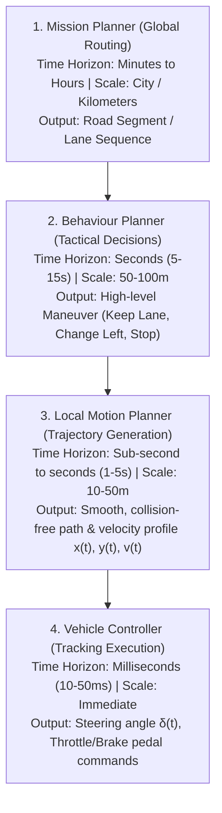

# Motion Planning Hierarchy in Autonomous Driving

## 1. Overview of Autonomous Driving Architecture

Autonomous driving motion planning must navigate complex, dynamic road environments in real-time. Because direct end-to-end continuous optimization over high-dimensional state spaces for long horizons is computationally intractable, autonomous driving systems decompose the problem hierarchically into distinct functional layers operating at different spatial and temporal scales:

---

## 2. Detailed Breakdown of Layers

### A. Mission Planner (Global Route Planning)
- **Inputs:** Current vehicle GPS position, destination coordinate, High-Definition (HD) road network topological graph.
- **Responsibilities:** Computes the highest-level topological sequence of road segments, intersections, and lanelets to navigate from origin to destination.
- **Update Frequency:** Event-driven (at trip start, or when a reroute is triggered by road closures or missed turns).
- **Core Algorithms:** Dijkstra's Algorithm, A* Search, Contraction Hierarchies.

### B. Behaviour Planner (Tactical Decision Making)
- **Inputs:** Global mission route, dynamic obstacle tracking states (predictions of pedestrians, cars, cyclists), traffic regulatory states (traffic lights, stop signs, speed limits).
- **Responsibilities:** Selects high-level tactical driving actions that adhere to driving rules and traffic etiquette while progressing along the mission.
  - *Examples:* "Follow Lead Vehicle", "Perform Left Lane Change", "Yield at Stop Sign", "Cross Uncontrolled Intersection".
- **Update Frequency:** 1 Hz – 10 Hz.
- **Core Algorithms:** Hierarchical Finite State Machines (HSMs), Decision Trees, Fuzzy Logic, Partially Observable Markov Decision Processes (POMDPs).

### C. Local / Motion Planner (Trajectory Generation)
- **Inputs:** Selected behaviour maneuver, current dynamic state $(x, y, \theta, v, a, \kappa)$, local obstacle representations (occupancy grid / bounding boxes), road boundaries.
- **Responsibilities:** Computes a continuous, kinematically and dynamically feasible trajectory $[x(t), y(t), \theta(t), v(t), a(t)]$ that is collision-free and maximizes comfort.
- **Update Frequency:** 10 Hz – 50 Hz.
- **Core Algorithms:** Trajectory Rollouts, Dynamic Window Approach (DWA), Conformal Spatiotemporal Lattices, Parametric Polynomial / Spiral Curves, Non-linear Optimization (SQP, CasADi).

### D. Vehicle Controller
- **Inputs:** Target trajectory $[x(t), y(t), v(t)]$, current vehicle localization and IMU/wheel odometry state.
- **Responsibilities:** Computes low-level actuator signals (steering wheel angle $\delta$, throttle %, braking pressure) to minimize tracking error (cross-track error $e_{ct}$, heading error $e_\theta$, velocity error $e_v$).
- **Update Frequency:** 50 Hz – 100 Hz.
- **Core Algorithms:** Pure Pursuit, Stanley Controller, Linear Quadratic Regulator (LQR), Model Predictive Control (MPC).
