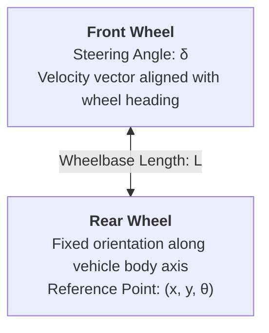

# Vehicle Kinematics, Dynamics & Planning Constraints

## 1. The Kinematic Bicycle Model

Standard 4-wheeled passenger vehicles are steered by the front wheels using Ackermann steering geometry. At low to moderate speeds where tire slip is negligible (no significant lateral skidding), the 4-wheel vehicle can be simplified into a 2-wheel **Kinematic Bicycle Model**:

### Mathematical State Equations (Rear Axle Reference)
Let the state vector be $\mathbf{x} = [x, y, \theta, v]^T$, where:
- $(x, y)$: 2D position of the center of the rear axle.
- $\theta$: Vehicle heading angle (orientation relative to world X-axis).
- $v$: Longitudinal velocity at the rear axle.
- $\delta$: Front steering angle (control input).
- $a$: Longitudinal acceleration (control input).
- $L$: Wheelbase length (distance between front and rear axles).

The continuous kinematic differential equations are:

$$\dot{x} = v \cos(\theta)$$

$$\dot{y} = v \sin(\theta)$$

$$\dot{\theta} = \frac{v}{L} \tan(\delta) = v \kappa$$

$$\dot{v} = a$$

Where $\kappa = \frac{\tan(\delta)}{L}$ is the path **curvature** ($m^{-1}$). The instantaneous radius of curvature is $R = \frac{1}{\kappa}$.

### Discrete-Time Integration (Euler & Runge-Kutta)
Given sampling time $\Delta t$, the Euler discretization is:

$$x_{k+1} = x_k + v_k \cos(\theta_k) \Delta t$$

$$y_{k+1} = y_k + v_k \sin(\theta_k) \Delta t$$

$$\theta_{k+1} = \theta_k + \frac{v_k}{L} \tan(\delta_k) \Delta t$$

$$v_{k+1} = v_k + a_k \Delta t$$

---

## 2. Fundamental Motion Planning Constraints

Any trajectory generated by the local planner must satisfy 5 classes of constraints:

### 1. Non-Holonomic Kinematic Constraints
A standard car cannot move directly sideways ($v_y = 0$ in vehicle body frame). Lateral velocity at the rear axle is zero:
$$-\dot{x} \sin(\theta) + \dot{y} \cos(\theta) = 0$$

### 2. Maximum Steering Angle & Curvature Bounds
Mechanical steering linkages limit the maximum steering angle $\delta_{max}$:
$$|\delta(t)| \le \delta_{max} \implies |\kappa(t)| \le \kappa_{max} = \frac{\tan(\delta_{max})}{L}$$
Minimum turning radius: $R_{min} = \frac{1}{\kappa_{max}} = \frac{L}{\tan(\delta_{max})}$.

### 3. Steering Rate (Curvature Rate / Sharpness) Limit
Steering actuators have maximum angular velocity $\dot{\delta}_{max}$:
$$|\dot{\delta}(t)| \le \dot{\delta}_{max} \implies |\dot{\kappa}(t)| \le \dot{\kappa}_{max}$$

### 4. Lateral Acceleration & Friction Ellipse (Dynamic Bounds)
Tire-road contact forces must remain within the traction limit defined by friction coefficient $\mu$:

$$a_{lat} = \frac{v^2}{R} = v^2 |\kappa| \le a_{lat, max}$$

Under combined braking/acceleration and cornering, longitudinal acceleration $a_{lon}$ and lateral acceleration $a_{lat}$ must satisfy the **Friction Ellipse (Kamm's Circle)**:

$$\left(\frac{a_{lon}}{a_{lon, max}}\right)^2 + \left(\frac{a_{lat}}{a_{lat, max}}\right)^2 \le 1$$

### 5. Collision & Road Boundary Constraints
The geometric footprint of the vehicle $\mathcal{V}(\mathbf{x}(t))$ must never intersect with static obstacle space $\mathcal{O}_{static}$ or dynamic obstacles $\mathcal{O}_{dynamic}(t)$, and must stay within the drivable road corridor $\mathcal{C}_{road}$:

$$\mathcal{V}(\mathbf{x}(t)) \cap \left(\mathcal{O}_{static} \cup \mathcal{O}_{dynamic}(t)\right) = \emptyset, \quad \mathcal{V}(\mathbf{x}(t)) \subset \mathcal{C}_{road} \quad \forall t$$
