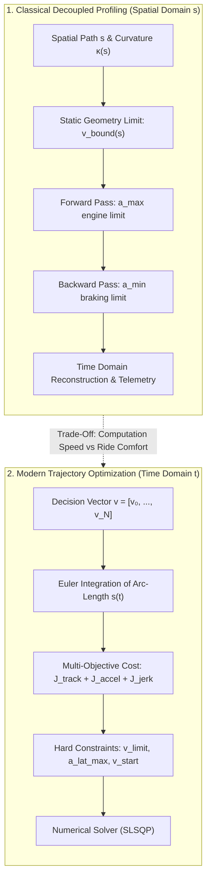
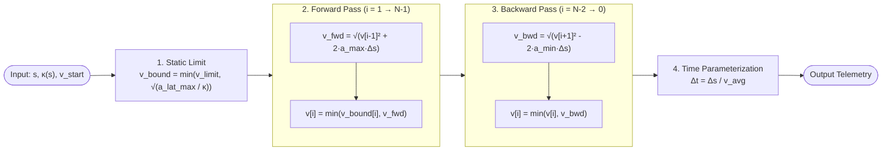
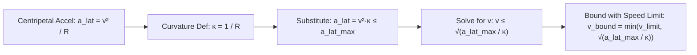
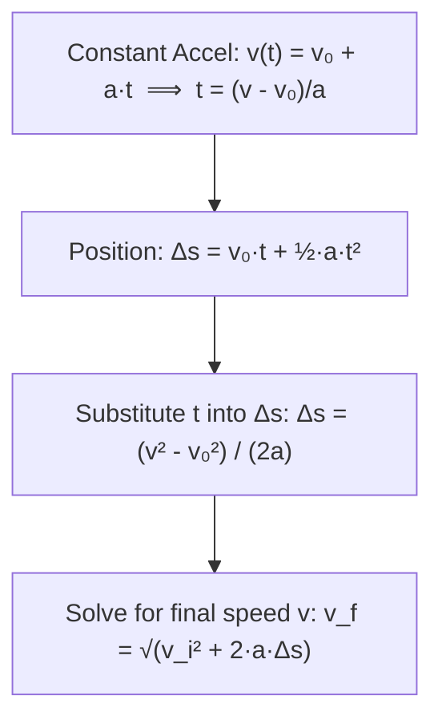
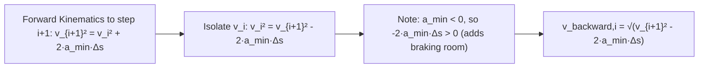
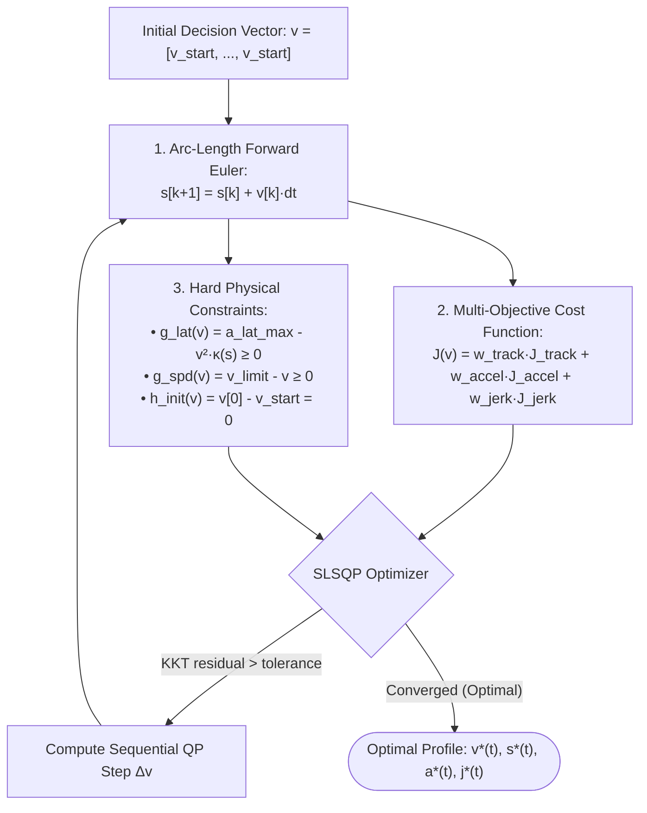
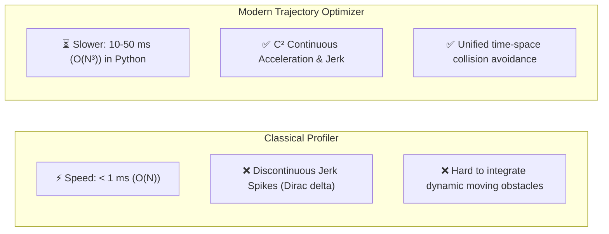

# Velocity Profiling & Trajectory Optimization (With Mathematical Derivations)

**Course:** Motion Planning for Self-Driving Cars  
**Module:** Week 01 | Session 01 (Introduction, Kinematic Constraints & Local Optimization)  
**Practice Labs:** [`practice/exercise_velocity_profile_optimization.ipynb`](../practice/exercise_velocity_profile_optimization.ipynb) | [`practice/solution_velocity_profile_optimization.py`](../practice/solution_velocity_profile_optimization.py)

---

## 🧭 Paradigm Overview



---

## 1. Classical Decoupled Velocity Profiling

### 📌 Conceptual Overview
Classical planning decouples the 2D spatial trajectory from time. Given a path $s \mapsto (x(s), y(s))$ with road curvature $\kappa(s)$, we determine the scalar speed profile $v(s)$ using kinematic limits before converting back to the time domain.



---

### 📐 Rigorous Equation Derivations

#### Derivation 1.1: Static Lateral Acceleration Bound ($v_{\text{bound}}$)



1. For a vehicle traveling at speed $v$ along a curve with instantaneous radius of curvature $R$, the centripetal (lateral) acceleration is:
   $$a_{\text{lat}} = \frac{v^2}{R}$$
2. Road curvature $\kappa(s)$ is geometrically defined as the reciprocal of the radius of curvature:
   $$\kappa(s) = \frac{1}{R(s)}$$
3. Substituting $\kappa(s)$ into the lateral acceleration formula:
   $$a_{\text{lat}}(s) = v(s)^2 \kappa(s)$$
4. To prevent tire slip and ensure passenger comfort, we enforce $a_{\text{lat}}(s) \le a_{\text{lat, max}}$:
   $$v(s)^2 \kappa(s) \le a_{\text{lat, max}} \implies v(s)^2 \le \frac{a_{\text{lat, max}}}{\kappa(s)} \implies v(s) \le \sqrt{\frac{a_{\text{lat, max}}}{\kappa(s)}}$$
5. Capping with the road speed limit $v_{\text{limit}}$ and adding a numerical regularizer $\varepsilon = 10^{-6}$ for straight sections ($\kappa \to 0$):
   $$\mathbf{v_{\text{bound}}(s) = \min\left(v_{\text{limit}}, \sqrt{\frac{a_{\text{lat, max}}}{\max(\kappa(s), 10^{-6})}}\right)}$$

---

#### Derivation 1.2: Torricelli’s Kinematic Equation (Forward Pass $v_{\text{forward}}$)



We derive the time-independent kinematic relation (Torricelli's Law) for constant longitudinal acceleration $a_{\text{max}}$ over spatial step $\Delta s = s_i - s_{i-1}$:

1. Velocity as a function of time under constant acceleration $a$:
   $$v(t) = v_0 + a t \implies t = \frac{v(t) - v_0}{a}$$
2. Spatial displacement $\Delta s = s(t) - s_0$:
   $$\Delta s = v_0 t + \frac{1}{2} a t^2$$
3. Eliminate time $t$ by substituting Step 1 into Step 2:
   $$\Delta s = v_0 \left(\frac{v - v_0}{a}\right) + \frac{1}{2} a \left(\frac{v - v_0}{a}\right)^2$$
   $$\Delta s = \frac{2 v_0 v - 2 v_0^2 + (v^2 - 2 v_0 v + v_0^2)}{2 a} = \frac{v^2 - v_0^2}{2 a}$$
4. Multiply by $2a$ and isolate $v^2$:
   $$v^2 = v_0^2 + 2 a \Delta s \implies v = \sqrt{v_0^2 + 2 a \Delta s}$$
5. Applying this from step $i-1$ to step $i$ with maximum engine/traction acceleration $a_{\text{max}}$:
   $$\mathbf{v_{\text{forward}, i} = \sqrt{\max\left(0.0, v_{i-1}^2 + 2 a_{\text{max}} \Delta s\right)}}$$
   $$\mathbf{v_i \leftarrow \min\left(v_{\text{bound}, i}, v_{\text{forward}, i}\right)}$$

---

#### Derivation 1.3: Backward Braking Integration ($v_{\text{backward}}$)



1. When approaching a sharp curve at index $i+1$, the vehicle must not exceed $v_{i+1}$. If the vehicle brakes with maximum deceleration $a_{\text{min}} < 0$ over the step $\Delta s = s_{i+1} - s_i$, standard forward kinematics dictates:
   $$v_{i+1}^2 = v_i^2 + 2 a_{\text{min}} \Delta s$$
2. Solving backwards for the maximum allowable speed $v_i$ at index $i$:
   $$v_i^2 = v_{i+1}^2 - 2 a_{\text{min}} \Delta s$$
3. Taking the square root:
   $$\mathbf{v_{\text{backward}, i} = \sqrt{\max\left(0.0, v_{i+1}^2 - 2 a_{\text{min}} \Delta s\right)}}$$
   *(Because $a_{\text{min}}$ is negative, e.g., $-3.0\,\text{m/s}^2$, the term $-2 a_{\text{min}} \Delta s = + 2 |a_{\text{min}}| \Delta s$ is positive, allowing higher entry speed prior to braking).*
4. Update the profile:
   $$\mathbf{v_i \leftarrow \min\left(v_i, v_{\text{backward}, i}\right)}$$

---

#### Derivation 1.4: Time Domain Telemetry Conversion

1. By definition, instantaneous velocity is $v = \frac{ds}{dt} \implies dt = \frac{ds}{v(s)}$.
2. Over a small segment $[s_{i-1}, s_i]$, we approximate the velocity using the **Trapezoidal average speed**:
   $$\bar{v}_i = \frac{v_i + v_{i-1}}{2}$$
3. The incremental time $\Delta t_i$ is:
   $$\Delta t_i = \frac{\Delta s_i}{\max(\bar{v}_i, 0.1)}, \quad t_i = t_{i-1} + \Delta t_i$$
4. Longitudinal acceleration and jerk are calculated using central difference numerical gradients:
   $$a(t_i) = \left.\frac{dv}{dt}\right|_{t_i} \approx \frac{v_{i+1} - v_{i-1}}{t_{i+1} - t_{i-1}}, \quad j(t_i) = \left.\frac{da}{dt}\right|_{t_i} \approx \frac{a_{i+1} - a_{i-1}}{t_{i+1} - t_{i-1}}$$

---

### 💻 Classical Python Implementation

```python
def compute_classical_velocity_profile(
    s_points: np.ndarray,
    v_start: float = 8.0,
    v_limit: float = 13.0,
    a_lat_max: float = 2.5,
    a_max: float = 2.0,
    a_min: float = -3.0
) -> dict:
    kappa = road_curvature(s_points)
    
    # 1. Static lateral speed limit (Derivation 1.1)
    v_bound = np.minimum(v_limit, np.sqrt(a_lat_max / np.maximum(kappa, 1e-6)))
    
    N = len(s_points)
    v_prof = np.zeros(N)
    v_prof[0] = v_start
    
    # 2. Forward pass (Derivation 1.2)
    for i in range(1, N):
        ds = s_points[i] - s_points[i - 1]
        v_forward = np.sqrt(max(0.0, v_prof[i - 1]**2 + 2.0 * a_max * ds))
        v_prof[i] = min(v_bound[i], v_forward)
        
    # 3. Backward pass (Derivation 1.3)
    for i in range(N - 2, -1, -1):
        ds = s_points[i + 1] - s_points[i]
        v_backward = np.sqrt(max(0.0, v_prof[i + 1]**2 - 2.0 * a_min * ds))
        v_prof[i] = min(v_prof[i], v_backward)
        
    # 4. Time domain conversion (Derivation 1.4)
    dt_arr = np.zeros(N)
    time_arr = np.zeros(N)
    for i in range(1, N):
        ds = s_points[i] - s_points[i - 1]
        v_avg = max(0.5 * (v_prof[i] + v_prof[i - 1]), 0.1)
        dt_arr[i] = ds / v_avg
        time_arr[i] = time_arr[i - 1] + dt_arr[i]
        
    accel = np.gradient(v_prof, time_arr)
    jerk = np.gradient(accel, time_arr)
    a_lat = (v_prof ** 2) * kappa
    x, y, theta = compute_2d_spatial_path(s_points, kappa)

    return {
        "s": s_points, "time": time_arr, "v": v_prof, "accel": accel,
        "jerk": jerk, "a_lat": a_lat, "kappa": kappa, "v_bound": v_bound,
        "x": x, "y": y, "theta": theta
    }
```

---

## 2. Modern Trajectory Optimization

### 📌 Conceptual Overview
Modern autonomous vehicle stacks formulate speed planning as a **Non-Linear Program (NLP)** directly in the time domain $t \in [0, N \Delta t]$. Instead of hard clipping, it finds a decision vector $\mathbf{v} = [v_0, v_1, \dots, v_N]^T$ that balances tracking performance with passenger ride comfort (minimizing jerk).



---

### 📐 Rigorous Equation Derivations

#### Derivation 2.1: Temporal State Integration ($s(t)$)
1. In the continuous time domain, velocity is the rate of change of arc position:
   $$\dot{s}(t) = \frac{ds}{dt} = v(t)$$
2. Integrating from $t_k$ to $t_{k+1} = t_k + \Delta t$:
   $$s(t_{k+1}) = s(t_k) + \int_{t_k}^{t_{k+1}} v(\tau) d\tau$$
3. Applying the **Forward Euler approximation**:
   $$\mathbf{s_{k+1} = s_k + v_k \Delta t}, \quad \text{with } s_0 = 0$$

---

#### Derivation 2.2: Finite Difference Approximations for Cost Terms

1. **Velocity Tracking Cost Functional:**
   Continuous integral:
   $$J_{\text{track}} = \int_0^T (v(t) - v_{\text{target}})^2 dt \approx \mathbf{\sum_{k=0}^{N} (v_k - v_{\text{target}})^2 \Delta t}$$

2. **Longitudinal Acceleration Cost Functional (Actuator Effort):**
   By forward finite differences, instantaneous acceleration is:
   $$a_k = \dot{v}(t_k) \approx \frac{v_{k+1} - v_k}{\Delta t}$$
   The continuous integral penalty $\int_0^T a(t)^2 dt$ discretizes to:
   $$\mathbf{J_{\text{accel}} = \sum_{k=0}^{N-1} \left(\frac{v_{k+1} - v_k}{\Delta t}\right)^2 \Delta t}$$

3. **Longitudinal Jerk Cost Functional (Ride Comfort):**
   Jerk is the time derivative of acceleration $j(t) = \dot{a}(t) = \ddot{v}(t)$:
   $$j_k \approx \frac{a_{k+1} - a_k}{\Delta t} = \frac{\frac{v_{k+2} - v_{k+1}}{\Delta t} - \frac{v_{k+1} - v_k}{\Delta t}}{\Delta t} = \frac{v_{k+2} - 2v_{k+1} + v_k}{\Delta t^2}$$
   The continuous integral penalty $\int_0^T j(t)^2 dt$ discretizes to:
   $$\mathbf{J_{\text{jerk}} = \sum_{k=0}^{N-2} \left(\frac{a_{k+1} - a_k}{\Delta t}\right)^2 \Delta t}$$

4. **Weighted Total Objective:**
   $$\mathbf{J(\mathbf{v}) = w_{\text{track}} J_{\text{track}} + w_{\text{accel}} J_{\text{accel}} + w_{\text{jerk}} J_{\text{jerk}}}$$

---

#### Derivation 2.3: Non-Linear Constraint Formulations

In standard mathematical optimization, SciPy's Sequential Least Squares Programming (SLSQP) solver enforces:
$$\begin{cases}
h_i(\mathbf{v}) = 0 & (\text{Equality constraints}) \\
g_j(\mathbf{v}) \ge 0 & (\text{Inequality constraints})
\end{cases}$$

1. **Initial Velocity Equality Constraint:**
   $$v(0) = v_{\text{start}} \implies \mathbf{h_{\text{init}}(\mathbf{v}) = v_0 - v_{\text{start}} = 0}$$
2. **Global Speed Limit Inequality Constraint:**
   $$v_k \le v_{\text{limit}} \implies \mathbf{g_{\text{spd}}(\mathbf{v}) = v_{\text{limit}} - v_k \ge 0}$$
3. **Lateral Comfort Acceleration Constraint:**
   At each timestep $k$, the vehicle is located at arc-length $s_k$. Centripetal acceleration is $a_{\text{lat}, k} = v_k^2 \kappa(s_k)$. Enforcing $a_{\text{lat}, k} \le a_{\text{lat, max}}$:
   $$v_k^2 \kappa(s_k) \le a_{\text{lat, max}} \implies \mathbf{g_{\text{lat}}(\mathbf{v}) = a_{\text{lat, max}} - v_k^2 \cdot \kappa(s_k) \ge 0}$$

---

### 💻 Modern Python Implementation

```python
def solve_modern_trajectory_optimization(
    N: int = 160,
    dt: float = 0.1,
    v_start: float = 8.0,
    v_target: float = 15.0,
    v_limit: float = 13.0,
    a_lat_max: float = 2.5,
    w_track: float = 1.0,
    w_accel: float = 2.0,
    w_jerk: float = 10.0
) -> dict:
    time = np.linspace(0, N * dt, N + 1)
    
    # 1. State integration along the horizon (Derivation 2.1)
    def get_s(v):
        s = np.zeros(N + 1)
        for k in range(N):
            s[k + 1] = s[k] + v[k] * dt
        return s

    # 2. Objective function: tracking + effort + comfort (Derivation 2.2)
    def objective(v):
        cost_track = np.sum((v - v_target) ** 2) * dt
        
        accel = np.diff(v) / dt
        cost_accel = np.sum(accel ** 2) * dt
        
        jerk = np.diff(accel) / dt
        cost_jerk = np.sum(jerk ** 2) * dt
        
        return w_track * cost_track + w_accel * cost_accel + w_jerk * cost_jerk

    # 3. Hard non-linear constraints (Derivation 2.3)
    def lat_accel_constraint(v):
        s = get_s(v)
        kappa = road_curvature(s)
        return a_lat_max - (v ** 2) * kappa

    def speed_limit_constraint(v):
        return v_limit - v

    bounds = [(0.0, v_limit) for _ in range(N + 1)]
    constraints = [
        {'type': 'eq', 'fun': lambda v: v[0] - v_start},
        {'type': 'ineq', 'fun': lat_accel_constraint},
        {'type': 'ineq', 'fun': speed_limit_constraint}
    ]
    
    v_init = np.full(N + 1, v_start)
    res = minimize(
        objective,
        v_init,
        method='SLSQP',
        bounds=bounds,
        constraints=constraints,
        options={'maxiter': 500, 'ftol': 1e-6}
    )
    
    v_opt = res.x
    s_opt = get_s(v_opt)
    kappa_opt = road_curvature(s_opt)
    accel_opt = np.gradient(v_opt, time)
    jerk_opt = np.gradient(accel_opt, time)
    a_lat_opt = (v_opt ** 2) * kappa_opt
    x_opt, y_opt, theta_opt = compute_2d_spatial_path(s_opt, kappa_opt)
    
    return {
        "s": s_opt, "time": time, "v": v_opt, "accel": accel_opt,
        "jerk": jerk_opt, "a_lat": a_lat_opt, "kappa": kappa_opt,
        "x": x_opt, "y": y_opt, "theta": theta_opt
    }
```

---

## ⚖️ Why Modern Optimization is Preferred Despite Being Slower



| Criterion | Classical Decoupled Profiling | Modern Trajectory Optimization |
| :--- | :--- | :--- |
| **Mathematical Domain** | Spatial coordinate $s$ | Temporal coordinate $t_k = k \Delta t$ |
| **Computational Complexity** | $\mathcal{O}(N)$ deterministic ($\approx 0.1\,\text{ms}$) | $\mathcal{O}(N^3)$ iterative ($10\text{–}50\,\text{ms}$ in Python; $1\text{–}3\,\text{ms}$ in C++ QP) |
| **Ride Comfort (Jerk)** | Discontinuous jumps at bounds | Explicitly minimized ($C^2$ smooth profile) |
| **Dynamic Moving Obstacles** | Difficult to coordinate in $s$ alone | Directly handled via moving box constraints in time $t$ |
| **Production AV Role** | Safety envelope / Emergency stop fallback | Primary nominal planning trajectory (Apollo, Autoware, Tesla FSD) |

---

## 🙋 Common Student Pitfalls & Teaching Tips

1. **Sign in Backward Pass:**  
   $a_{\text{min}}$ is a negative number (e.g. $-3.0\,\text{m/s}^2$). Students often write $+2 a_{\text{min}} \Delta s$, which produces negative values under $\sqrt{\cdot}$ and crashes. Show them that $-2 a_{\text{min}} \Delta s = +2 |a_{\text{min}}| \Delta s$.
2. **SciPy Inequality Convention:**  
   `minimize(..., constraints={'type': 'ineq'})` assumes $g(x) \ge 0$. If students return `(v**2)*kappa - a_lat_max`, they are requiring $a_{\text{lat}} \ge a_{\text{lat, max}}$, forcing the optimizer to take turns dangerously fast.
3. **Finite Difference Sizing:**  
   Remind students that `np.diff(v)` has length $N$, while `np.diff(accel)` has length $N-1$.
