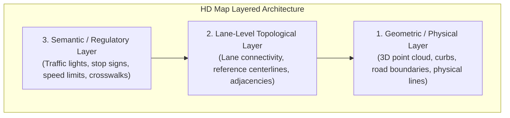
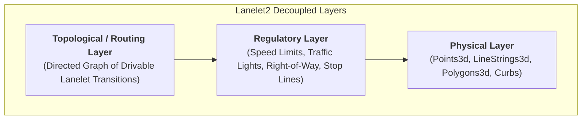
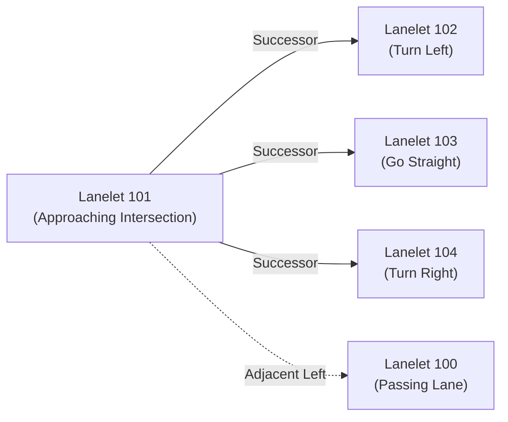

# HD Maps, Lanelet2 & Road Network Representations

## 1. High-Definition (HD) Vector Maps in Autonomous Driving

Unlike consumer navigation maps (e.g., Google Maps or standard OpenStreetMap) which provide meter-level road centerlines for turn-by-turn routing, autonomous driving stacks require **centimeter-accurate High-Definition (HD) Maps**. These maps provide the geometric, topological, and semantic prior required for mission planning, behavior selection, and lane-level localization.



---

## 2. HD Map Standards Comparison

Autonomous vehicle architectures primarily utilize three leading HD map formats:

| Feature / Standard      | **Lanelet / Lanelet2**                                    | **OpenDRIVE (ASAM)**                                      | **Apollo HD Map**                                        |
| :---------------------- | :-------------------------------------------------------- | :-------------------------------------------------------- | :------------------------------------------------------- |
| **Origin**              | KIT / FZI Karlsruhe                                       | VIRES / ASAM Consortium                                   | Baidu Apollo Open Platform                               |
| **Philosophy**          | Geometry-first, micro-segment atomic primitives           | Parametric clothoid/spiral road descriptions              | Vector polygon format optimized for Protobuf             |
| **Lane Representation** | Left & right physical boundaries with derived centerlines | Analytical reference line with polynomial lateral offsets | Polygonal line strings & crosswalk / junction boundaries |
| **Regulatory Elements** | First-class objects linked to specific lanelets           | Parameterized signal objects placed along reference line  | Associated semantic signal and stop line annotations     |
| **Routing / Planning**  | Native directed graph representation                      | Analytical lane-section linking                           | Graph adjacency built from protobuf nodes                |

---

## 3. The Lanelet2 Architecture

**Lanelet2** (Poggenhans et al., 2018) organizes map information into three distinct, decoupled layers:




### 3.1. Physical Primitives
1. **Point3d:** An exact 3D coordinate $[X, Y, Z]$ with global GPS / UTM coordinates.
2. **LineString3d:** An ordered sequence of points defining physical markings (solid line, dashed line, curb, barrier).
3. **Polygon3d:** A closed sequence of points bounding 2D/3D areas (parking lots, pedestrian zones, no-go zones).

### 3.2. Drivable Primitives: The Lanelet
A **Lanelet** is an atomic drivable road segment uniquely bounded by:
- **Left Boundary:** `LineString3d` $[p_0^L, p_1^L, \dots, p_n^L]$
- **Right Boundary:** `LineString3d` $[p_0^R, p_1^R, \dots, p_n^R]$
- **Centerline (Derived or Explicit):** The interpolated centerline $p_i^C = \frac{p_i^L + p_i^R}{2}$ providing reference arc length $s$.
- **Regulatory Elements:** Associated traffic rules applicable within this lanelet.

```
       p0_L ────────── p1_L ────────── p2_L (Left Boundary)
         │               │               │
         · - - - - - - - · - - - - - - - · (Centerline Reference Path)
         │      Lanelet Driving Direction ▶
       p0_R ────────── p1_R ────────── p2_R (Right Boundary)
```

> **Key Rule:** A new lanelet is instantiated whenever a regulatory condition changes (e.g. speed limit change, beginning of a merge) or when physical lane topology splits or joins.

### 3.3. Regulatory Elements (RegEls)
Regulatory elements attach behavioral rules directly to lanelet objects:
- **Traffic Lights:** Links lanelet to the physical location of the signal head and the exact stopping polyline.
- **Right of Way:** Explicitly identifies which intersecting lanelet has yield vs priority rules.
- **Speed Limits:** Maximum, minimum, and advisory velocities.
- **Crosswalks:** Pedestrian priority zones triggering yield behaviors.

---

## 4. Graph Generation for Mission Planning

To enable global pathfinding (via Dijkstra or A* search), the continuous geometric HD map is converted into a **Weighted Directed Graph** $\mathcal{G} = (\mathcal{V}, \mathcal{E})$:



### Graph Connections:
1. **Longitudinal Successor / Predecessor Edges:** Consecutive lanelets along the direction of traffic flow.
2. **Lateral Adjacent Edges:** Adjacent lanelets sharing a common boundary (differentiates between legal dashed markings vs illegal solid lines).
3. **Conflicting Intersection Edges:** Identifies overlapping spatial corridors inside junctions for multi-agent collision avoidance.

---

## 5. Summary & Role in the Autonomous Driving Stack

- **Localization:** Compares real-time LiDAR scans and camera lane detections against HD Map geometry for centimeter-level localization.
- **Mission Planning:** Traverses the topological Lanelet graph to generate route waypoints.
- **Behavior Planning:** Reads regulatory elements (stop lines, traffic lights, speed limits) to govern state transitions.
- **Local Trajectory Planning:** Uses lanelet centerlines as the reference trajectory $\mathbf{r}(s)$ to define road-aligned Frenet coordinates.
