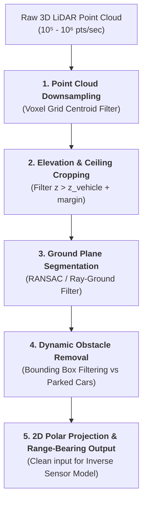
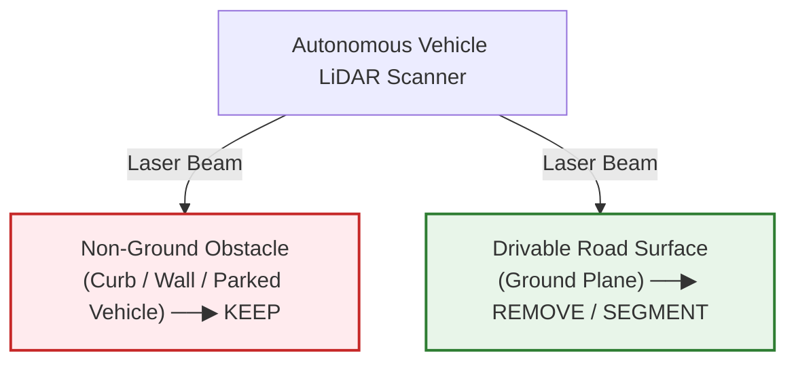

# LiDAR Point Cloud Preprocessing & Filtering for Mapping

Before raw 3D LiDAR point clouds can be fed into an occupancy grid mapping pipeline or collision checking engine, they must undergo structured preprocessing. Raw point clouds contain millions of points per second including ground reflections, overhanging foliage, and moving vehicles that must not be integrated into static obstacle maps.

---

## 1. Point Cloud Downsampling (Voxel Grid Filtering)

Raw LiDAR sensors (e.g., 32, 64, or 128-beam scanners) generate $10^5$ to $10^6$ points per second. Processing every point introduces severe computational bottlenecks without adding spatial information.

### Voxel Grid Filtering:
- The 3D space is divided into discrete cubic voxels of size $s_v$ (e.g. $0.05\,\text{m} \times 0.05\,\text{m} \times 0.05\,\text{m}$).
- All points $p_k \in \text{Voxel}_j$ are replaced by their geometric centroid:
  $$p_{\text{centroid}} = \frac{1}{N} \sum_{k=1}^N p_k$$
- **Benefit:** Dramatically reduces point count, ensures uniform point density across distance, and retains surface geometry.

---

## 2. Overhanging Object Removal (Ceiling Filtering)

Autonomous vehicles only need to avoid obstacles within their physical vertical corridor:

$$Z_{\min}^{\text{drivable}} \le Z_p \le Z_{\text{vehicle\_height}} + \delta_{\text{clearance}}$$

- **Overhanging Objects:** Overhead highway signs, traffic lights, overpasses, bridges, and tree branches.
- Points where $Z_p > Z_{\text{car\_height}} + \delta_{\text{margin}}$ (typically $> 2.2\,\text{m} - 2.5\,\text{m}$) are filtered out so they are not projected down as impassable ground obstacles.

---

## 3. Ground Plane Segmentation

The ground plane represents the **drivable road surface**. If ground points were treated as obstacle hits in an occupancy grid, the entire road ahead would be classified as an impenetrable barrier.

### Techniques for Ground Plane Extraction:

#### A. RANSAC Planar Fitting
- Fits a 3D plane model $ax + by + cz + d = 0$ to points near the expected road level ($z \approx 0$).
- Points within a distance threshold $\epsilon_{\text{ground}} \approx 0.05\,\text{m} - 0.1\,\text{m}$ to the plane are classified as ground and removed.
- *Limitation:* Struggles with hilly terrain, steep slopes, and non-planar road crowning.

#### B. Concentric Zone Elevation / Ray-Ground Filtering
- The space around the vehicle is divided into radial sectors and concentric distance rings.
- Points are evaluated sequentially along each radial ray; slope transitions $\Delta z / \Delta r$ greater than a threshold (e.g., $> 10\%-15\%$) are flagged as obstacles (curbs, walls), while flat transitions are classified as ground.

---

## 4. Dynamic Object Removal & Static Map Integrity

Occupancy grids assume the environment is **strictly static**. If a moving car or pedestrian is updated into a static occupancy grid:
- A "ghost trail" of false occupied cells will form behind the moving object.
- The path planner will attempt to avoid phantom obstacles that are no longer there.

### Dynamic Removal Pipeline:
1. **Perception Stack Bounding Boxes:** Object detection and multi-object tracking (MOT) identify dynamic actors (vehicles, pedestrians, cyclists) and output 3D oriented bounding boxes.
2. **Bounding Box Dilation:** The bounding box is slightly expanded by margin $\epsilon \approx 0.2\,\text{m}$ to account for tracking latency and localization noise.
3. **Point Removal:** All LiDAR returns falling inside active dynamic bounding boxes are excluded from the static occupancy grid update.
4. **Distinguishing Parked vs. Moving Vehicles:** 
   - Tracking history is analyzed over a time window $\Delta T$.
   - If velocity $\|\mathbf{v}\| < 0.1\,\text{m/s}$ for $> 5$ seconds, the vehicle is classified as a **static obstacle** (e.g. parked car) and retained in the occupancy grid.

---

## 5. Mapping Destination: 2D Projection vs. 3D Voxel Integration

Once the filtered, static non-ground point cloud $\mathcal{P}_{\text{clean}} = \{ (x_i, y_i, z_i) \}$ is obtained, it is routed based on the grid dimensionality:
* **For 2D Occupancy Grids:** Points within the vehicle height window are projected onto the horizontal $(x, y)$ plane by dropping $z_i$, and converted into sensor-centric polar coordinates (range $r_i$ and azimuth $\phi_i$) for 2D ray casting and inverse sensor model updates.
* **For 3D Occupancy Grids (Voxel Grids / OctoMaps):** The full 3D coordinates $(x_i, y_i, z_i)$ and 3D ray trajectories from the sensor origin are preserved for volumetric voxel updates (e.g. 3D Bresenham ray traversal).
