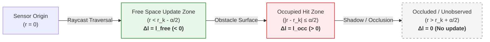
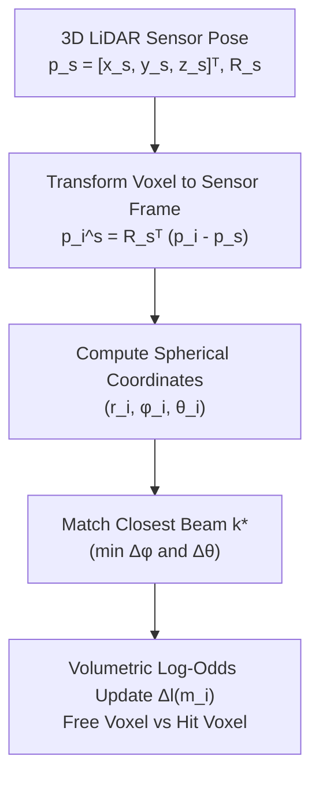
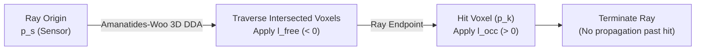

# LiDAR Inverse Sensor Model (2D & 3D)

The **Inverse Sensor Model (ISM)** computes the conditional probability $P(m_i \mid z_t, x_t)$—or directly the log-odds update $\Delta l(m_i)$—of a spatial cell or voxel $m_i$ given a sensor measurement $z_t$ and sensor pose $x_t$.

---

## 1. Beam Geometry & Ray Propagation

When a laser pulse with measured range $r_k$ is emitted from the sensor origin into space, it defines three distinct physical zones along its line-of-sight:

1. **Free Space Region ($r < r_k - \frac{\alpha}{2}$):** The beam traveled through unblocked air. Space along the ray is empty ($\Delta l = l_{\text{free}} < 0$).
2. **Occupied Surface Region ($|r - r_k| \le \frac{\alpha}{2}$):** The beam hit and reflected off an obstacle surface of thickness/uncertainty $\alpha$ ($\Delta l = l_{\text{occ}} > 0$).
3. **Occluded / Unobserved Region ($r > r_k + \frac{\alpha}{2}$):** The beam was absorbed or reflected; space behind the obstacle is shadowed ($\Delta l = 0$, no update).

---

## 2. 2D Inverse Sensor Model (Planar Range-Bearing)

For a single-layer 2D LiDAR (or a 3D cloud projected to 2D) and planar grid cell $m_i = (x_i, y_i)$ relative to sensor pose $(x_v, y_v, \theta_v)$:

### Step 1: Polar Transformation
$$r_i = \sqrt{(x_i - x_v)^2 + (y_i - y_v)^2}$$
$$\phi_i = \operatorname{atan2}(y_i - y_v, x_i - x_v) - \theta_v$$

### Step 2: Beam Matching
Find the closest beam index $k^*$:
$$k^* = \arg\min_{k} |\phi_i - \phi_k|$$

### Step 3: Piecewise Log-Odds Assignment
$$\Delta l(m_i) = 
\begin{cases} 
l_{\text{occ}} & \text{if } |r_i - r_{k^*}| \le \frac{\alpha}{2} \text{ and } |\phi_i - \phi_{k^*}| \le \frac{\beta}{2} \\
l_{\text{free}} & \text{if } r_i < r_{k^*} - \frac{\alpha}{2} \text{ and } |\phi_i - \phi_{k^*}| \le \frac{\beta}{2} \\
0 & \text{otherwise (beyond obstacle or outside FOV)}
\end{cases}$$

Where:
- $\alpha$: Range uncertainty / obstacle boundary thickness (e.g. $0.2\,\text{m}$).
- $\beta$: Horizontal beam divergence / angular aperture.
- $l_{\text{occ}} = \operatorname{logit}(P_{\text{occ}})$, typically $P_{\text{occ}} \approx 0.70 - 0.85 \implies l_{\text{occ}} \in [+0.85, +1.73]$.
- $l_{\text{free}} = \operatorname{logit}(P_{\text{free}})$, typically $P_{\text{free}} \approx 0.30 - 0.40 \implies l_{\text{free}} \in [-0.85, -0.40]$.

---

## 3. 3D Inverse Sensor Model (Volumetric Spherical Coordinates)

Multi-beam spinning LiDARs (e.g., 32/64/128 beams) and solid-state LiDARs generate points across both **azimuth** ($\phi$) and **elevation** ($\theta$).

### Step 1: 3D Coordinate Transformation
For a 3D voxel center $\mathbf{p}_i = [x_i, y_i, z_i]^T$ and sensor 6-DoF pose $\mathbf{p}_s = [x_s, y_s, z_s]^T$ with rotation matrix $\mathbf{R}_s \in \mathrm{SO}(3)$:

$$\mathbf{p}_i^s = \begin{bmatrix} x_i^s \\ y_i^s \\ z_i^s \end{bmatrix} = \mathbf{R}_s^T (\mathbf{p}_i - \mathbf{p}_s)$$

### Step 2: 3D Spherical Coordinates
Compute range $r_i$, azimuth $\phi_i$, and elevation $\theta_i$:

$$r_i = \|\mathbf{p}_i^s\|_2 = \sqrt{(x_i^s)^2 + (y_i^s)^2 + (z_i^s)^2}$$
$$\phi_i = \operatorname{atan2}(y_i^s, x_i^s) \quad \in [-\pi, \pi]$$
$$\theta_i = \arcsin\left(\frac{z_i^s}{r_i}\right) = \operatorname{atan2}\left(z_i^s, \sqrt{(x_i^s)^2 + (y_i^s)^2}\right) \quad \in [-\frac{\pi}{2}, \frac{\pi}{2}]$$

### Step 3: Multi-Beam Matching in 3D
For a sensor with beam channels indexed by $k$ (each having elevation $\theta_k$ and azimuth $\phi_k$):

$$k^* = \arg\min_k \left[ \left(\frac{\phi_i - \phi_k}{\beta_\phi}\right)^2 + \left(\frac{\theta_i - \theta_k}{\beta_\theta}\right)^2 \right]$$

### Step 4: Volumetric 3D Log-Odds Update
$$\Delta l(m_i) = 
\begin{cases} 
l_{\text{occ}} & \text{if } |r_i - r_{k^*}| \le \frac{\alpha}{2}, \; |\phi_i - \phi_{k^*}| \le \frac{\beta_\phi}{2}, \; |\theta_i - \theta_{k^*}| \le \frac{\beta_\theta}{2} \\
l_{\text{free}} & \text{if } r_i < r_{k^*} - \frac{\alpha}{2}, \; |\phi_i - \phi_{k^*}| \le \frac{\beta_\phi}{2}, \; |\theta_i - \theta_{k^*}| \le \frac{\beta_\theta}{2} \\
0 & \text{otherwise}
\end{cases}$$

Where:
- $\beta_\phi$: Horizontal angular resolution / beam divergence.
- $\beta_\theta$: Vertical angular beam spacing (e.g. $0.33^\circ - 1.0^\circ$ depending on beam channel distribution).

---

## 4. Efficient 3D Implementation: Fast Voxel Traversal (Ray Casting)

Iterating over every 3D voxel in space and evaluating spherical equations is computationally unfeasible ($O(N_{\text{voxels}} \times N_{\text{beams}})$).

In practical autonomous systems (e.g., **OctoMap**, **UFOMap**, or GPU voxel hashing), the 3D ISM is implemented via **Forward Ray Casting**:

### Algorithm: 3D Amanatides-Woo (Voxel DDA)
1. For each received 3D return $\mathbf{p}_k = [x_k, y_k, z_k]^T$:
2. Construct the directional ray vector:
   $$\mathbf{v}_{\text{ray}} = \mathbf{p}_k - \mathbf{p}_s$$
3. Trace the ray through the 3D grid using **3D Digital Differential Analysis (DDA)**:
   - For every intermediate voxel traversed before the endpoint:
     $$l(m_{\text{step}}) \leftarrow \max\big(l_{\min}, \; l(m_{\text{step}}) + l_{\text{free}}\big)$$
   - For the terminating voxel containing $\mathbf{p}_k$:
     $$l(m_{\text{endpoint}}) \leftarrow \min\big(l_{\max}, \; l(m_{\text{endpoint}}) + l_{\text{occ}}\big)$$

---

## 5. Summary: 2D vs. 3D Inverse Sensor Model

| Property                     | 2D LiDAR ISM                                                         | 3D LiDAR ISM                                                                          |
| :--------------------------- | :------------------------------------------------------------------- | :------------------------------------------------------------------------------------ |
| **Coordinate Space**         | Polar $(r, \phi)$ on $(x, y)$ plane                                  | Spherical $(r, \phi, \theta)$ in 3D $(x, y, z)$                                       |
| **Grid Representation**      | 2D Matrix ($H \times W$)                                             | 3D Voxel Grid / Hierarchical Octree                                                   |
| **Ray-Casting Algorithm**    | 2D Bresenham / 2D DDA                                                | 3D Amanatides-Woo / Octree ray casting                                                |
| **Handling Overhangs**       | Drops $z$; requires height pre-filtering                             | Naturally preserves tunnels, bridges, overpasses                                      |
| **Computational Complexity** | $O(N_{\text{rays}} \cdot L_{\text{grid}})$ (Very fast, CPU realtime) | $O(N_{\text{points}} \cdot L_{\text{voxels}})$ (Requires Octrees or GPU acceleration) |
| **Primary Use Case**         | Structured on-road driving, flat highways                            | Multi-level garages, urban canyons, UAVs, off-road                                    |
