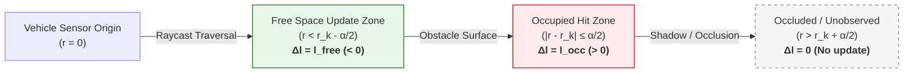

# LiDAR Inverse Sensor Model

## 1. Beam-Based Sensor Geometry

A 2D LiDAR scanner emits laser pulses at discrete azimuth angles $\phi_k \in [-\pi, \pi]$ and measures return time-of-flight to determine range $r_k \in [r_{min}, r_{max}]$.

When a laser beam with measured range $r_k$ passes through space:
1. **Free Space Region ($r < r_k - \frac{\alpha}{2}$):** The space along the beam is empty (free of obstacles).
2. **Occupied Surface Region ($r_k - \frac{\alpha}{2} \le r \le r_k + \frac{\alpha}{2}$):** The beam reflected off an object of thickness $\alpha$.
3. **Occluded / Unobserved Region ($r > r_k + \frac{\alpha}{2}$):** The laser beam was blocked; no information is available.

---

## 2. Mathematical Definition of Inverse Range-Bearing Model

For a given grid cell center $m_i = (x_i, y_i)$ relative to vehicle sensor pose $(x_v, y_v, \theta_v)$:

1. Compute relative range $r_i$ and relative bearing $\phi_i$:

$$r_i = \sqrt{(x_i - x_v)^2 + (y_i - y_v)^2}$$

$$\phi_i = \operatorname{atan2}(y_i - y_v, x_i - x_v) - \theta_v$$

2. Match to the closest sensor beam index $k^*$:

$$k^* = \arg\min_{k} |\phi_i - \phi_k|$$

3. Assign the log-odds update:

$$\operatorname{inverse\_sensor\_model}(m_i, z_t, x_t) = 
\begin{cases} 
l_{occ} & \text{if } |r_i - r_{k^*}| \le \frac{\alpha}{2} \text{ and } |\phi_i - \phi_{k^*}| \le \frac{\beta}{2} \\
l_{free} & \text{if } r_i < r_{k^*} - \frac{\alpha}{2} \text{ and } |\phi_i - \phi_{k^*}| \le \frac{\beta}{2} \\
l_0 & \text{otherwise (beyond hit or outside FOV)}
\end{cases}$$

Where:
- $\alpha$: Obstacle thickness / range uncertainty margin (e.g. $0.2m$).
- $\beta$: Beam angular opening width.
- $l_{occ} = \log\left(\frac{P_{occ}}{1 - P_{occ}}\right)$ with $P_{occ} = 0.85 \implies l_{occ} \approx +1.73$.
- $l_{free} = \log\left(\frac{P_{free}}{1 - P_{free}}\right)$ with $P_{free} = 0.3 \implies l_{free} \approx -0.85$.
