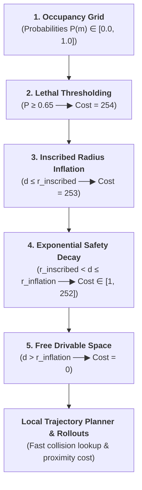
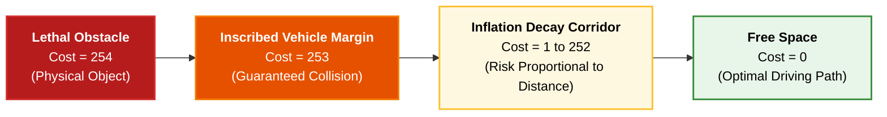

# Costmaps, Inflation Layers & Drivability Grids

While an **Occupancy Grid** estimates the binary probability of physical obstacle presence $P(m_i = 1)$, motion planners (such as A*, Dijkstra, Lattice planners, or Trajectory Rollout algorithms) cannot plan directly on raw occupancy probabilities. 

To ensure safety margins, penalize proximity to obstacles, and treat the vehicle as a point or circle during collision checking, occupancy grids are converted into **Costmaps with Inflation Layers**.



---

## 1. The Need for Costmap Inflation

A standard vehicle is not an infinitely small point; it has finite dimensions (e.g. length $L = 4.8\,\text{m}$, width $W = 2.0\,\text{m}$).

If a path planner only checks whether the vehicle's center point $[x, y]$ intersects an occupied cell:
- The corners and sides of the car would collide with adjacent walls, curbs, or parked cars.
- By **inflating** obstacles outward by the vehicle's geometry, the path planner can treat the autonomous vehicle as a simplified **point robot** in the configuration space ($\mathcal{C}_{\text{space}}$).

---

## 2. Costmap Layer Hierarchy

Standard autonomous driving costmaps (such as the ROS / Autoware / Apollo Costmap architectures) define discrete cost zones based on distance $d$ to the nearest obstacle:



### 2.1. Cost Categories:
1. **Lethal Obstacle (`cost = 254`):** Grid cells where the occupancy grid probability exceeds the obstacle threshold $P(m_i) \ge P_{\text{threshold}}$ (typically $\ge 0.65$).
2. **Inscribed Vehicle Inflation (`cost = 253`):** Any cell within the vehicle's inscribed radius $r_{\text{inscribed}} = \frac{W}{2}$ of a lethal obstacle. If the vehicle's center of mass enters this zone, a physical collision is guaranteed.
3. **Decaying Cost Corridor (`cost = [1, 252]`):** A buffer region beyond $r_{\text{inscribed}}$ up to an inflation radius $r_{\text{inflation}}$ (e.g. $1.5\,\text{m} - 2.5\,\text{m}$). The cost decays smoothly with distance:
   $$\text{cost}(d) = \text{cost}_{\text{inscribed}} \cdot \exp\left(-\zeta \cdot (d - r_{\text{inscribed}})\right)$$
   Where:
   - $d$: Euclidean distance to the nearest lethal obstacle cell.
   - $\zeta$: Inflation decay scaling factor.
4. **Free Space (`cost = 0`):** Safe, unobstructed drivable area far from obstacles.
5. **Unknown Space (`cost = 255`):** Unobserved / occluded grid cells.

---

## 3. Distance Transform for Fast Computation

Computing the Euclidean distance from every free cell to its nearest obstacle cell using naive search is $O(N \cdot M \cdot K)$, which is too slow for real-time loops ($20-50\,\text{Hz}$).

In practice, the **Exact Euclidean Distance Transform (EDT)** (Felzenszwalb & Huttenlocher algorithm) or `scipy.ndimage.distance_transform_edt` is used to compute distances across the entire grid in linear time $O(N \times M)$:

```python
import numpy as np
from scipy.ndimage import distance_transform_edt

def compute_costmap(occupancy_grid: np.ndarray, 
                    prob_threshold: float = 0.65,
                    resolution: float = 0.2, 
                    r_inscribed: float = 1.0, 
                    r_inflation: float = 2.5, 
                    decay_factor: float = 2.0) -> np.ndarray:
    """
    Computes an inflated safety costmap from an occupancy probability grid.
    """
    # 1. Identify binary lethal obstacles
    lethal_mask = occupancy_grid >= prob_threshold
    
    # 2. Compute exact distance from every cell to nearest lethal obstacle in meters
    distance_grid = distance_transform_edt(~lethal_mask) * resolution
    
    # 3. Initialize costmap
    costmap = np.zeros_like(occupancy_grid, dtype=np.uint8)
    
    # Lethal zone
    costmap[lethal_mask] = 254
    
    # Inscribed zone
    inscribed_mask = (~lethal_mask) & (distance_grid <= r_inscribed)
    costmap[inscribed_mask] = 253
    
    # Inflation decay zone
    decay_mask = (~lethal_mask) & (distance_grid > r_inscribed) & (distance_grid <= r_inflation)
    dist_diff = distance_grid[decay_mask] - r_inscribed
    costmap[decay_mask] = np.uint8(253 * np.exp(-decay_factor * dist_diff))
    
    return costmap
```

---

## 4. Role in Trajectory Rollouts & Local Planners

When evaluating a candidate trajectory $\tau = \{(x_k, y_k)\}_{k=1}^K$:
1. The planner queries the costmap at each waypoint index:
   $$J_{\text{obstacle}}(\tau) = \sum_{k=1}^K \text{Costmap}(x_k, y_k)$$
2. If any waypoint has $\text{Costmap}(x_k, y_k) \ge 253$, the trajectory is immediately discarded as an **invalid collision trajectory**.
3. Among valid trajectories, the optimizer chooses the one that minimizes both length, deviation from centerline, and obstacle proximity cost.
