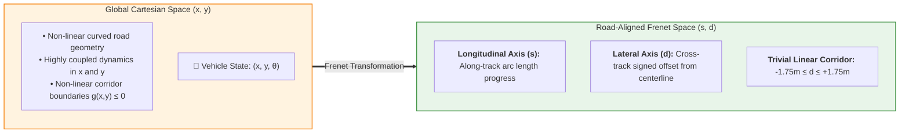
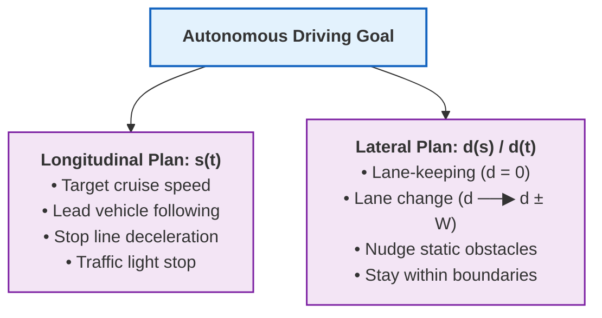

# Road-Aligned Coordinate Systems & The Frenet Transformation

## 1. Motivation: Why Cartesian Coordinates Fail for Highway & Urban Planning

In global Cartesian space $(x, y, \theta)$, driving tasks like lane-keeping, lane changes, and vehicle-following are mathematically complex because the road geometry itself is non-linear and continuously curving:

- **Coupled Dynamics:** In $(x, y)$, lateral lane adjustments require continuous adjustments in both $x$ and $y$ simultaneously.
- **Complex Constraints:** Expressing road boundaries (e.g., "stay within $\pm 1.75\,\text{m}$ of lane center") becomes a complex set of non-linear parametric curve constraints $g(x, y) \le 0$.
- **Hard Progress Tracking:** Measuring how far along a route a vehicle has traveled requires integrating arc length along an arbitrary curve.

To overcome this, autonomous vehicle motion planners transform state representations into a **road-aligned curvilinear coordinate frame**, universally known as the **Frenet-Serret Frame** (or simply **Frenet Frame**).



---

## 2. Mathematical Definition of the Frenet Frame

Let the road centerline (extracted from an HD Map Lanelet or global mission route) be represented as a smooth, continuous reference path $\mathbf{r}(s) = [x_r(s), y_r(s)]^T$ parameterized by arc length $s \in [0, s_{\max}]$.

At any arc length $s$, the reference curve defines:
1. **Unit Tangent Vector $\mathbf{t}_r(s)$:**
   $$\mathbf{t}_r(s) = \begin{bmatrix} \cos\theta_r(s) \\ \sin\theta_r(s) \end{bmatrix}$$
   where $\theta_r(s) = \arctan2\left(\frac{dy_r}{ds}, \frac{dx_r}{ds}\right)$ is the reference path heading.

2. **Unit Normal Vector $\mathbf{n}_r(s)$** (pointing perpendicular to the left of travel):
   $$\mathbf{n}_r(s) = \begin{bmatrix} -\sin\theta_r(s) \\ \cos\theta_r(s) \end{bmatrix}$$

3. **Reference Curvature $\kappa_r(s)$:**
   $$\kappa_r(s) = \frac{d\theta_r}{ds}$$

### State Coordinates in Frenet Space: $(s, d)$
Any point $\mathbf{p} = [x, y]^T$ in the plane is decomposed into two decoupled scalar coordinates:
- **Longitudinal coordinate ($s$):** The along-track arc length of the closest point $\mathbf{r}(s)$ on the reference curve.
- **Lateral coordinate ($d$):** The signed perpendicular cross-track distance from the reference path:
  - $d > 0$: Vehicle is to the **left** of the centerline.
  - $d = 0$: Vehicle is exactly on the **centerline**.
  - $d < 0$: Vehicle is to the **right** of the centerline.

$$\mathbf{p}(s, d) = \mathbf{r}(s) + d \cdot \mathbf{n}_r(s)$$

---

## 3. Coordinate Transformations

### 3.1. Frenet-to-Cartesian Transformation $((s, d) \to (x, y, \theta))$

Given Frenet state $(s, \dot{s}, \ddot{s}, d, d', d'')$ where $(\cdot)' = \frac{d}{ds}$:

1. **Cartesian Position $(x, y)$:**
   $$x(s, d) = x_r(s) - d \sin\theta_r(s)$$
   $$y(s, d) = y_r(s) + d \cos\theta_r(s)$$

2. **Vehicle Heading $\theta$:**
   $$\theta(s, d, d') = \theta_r(s) + \Delta\theta$$
   $$\Delta\theta = \arctan\left(\frac{d'}{1 - d \cdot \kappa_r(s)}\right)$$

3. **Vehicle Curvature $\kappa$:**
   $$\kappa(s, d, d', d'') = \frac{\left( \frac{d'' + (d' \kappa_r + (1 - d\kappa_r)\tan\Delta\theta) \kappa_r}{(1 - d\kappa_r)\cos\Delta\theta} + \kappa_r \right) \cos\Delta\theta}{1 - d\kappa_r}$$

---

### 3.2. Cartesian-to-Frenet Transformation $((x, y, \theta) \to (s, d, \Delta\theta))$

Given an arbitrary vehicle pose $\mathbf{p} = [x, y]^T$ in global coordinates:

1. **Find the Projection Point $s^*$:**
   Find the arc length $s^*$ that minimizes Euclidean distance to the reference path:
   $$s^* = \arg\min_{s} \|\mathbf{p} - \mathbf{r}(s)\|_2$$

2. **Compute Signed Lateral Offset $d$:**
   $$\mathbf{d}_{vec} = \mathbf{p} - \mathbf{r}(s^*)$$
   $$d = \text{sign}\left(\mathbf{d}_{vec} \times \mathbf{t}_r(s^*)\right) \|\mathbf{d}_{vec}\|_2 = (x - x_r(s^*))(-\sin\theta_r(s^*)) + (y - y_r(s^*))(\cos\theta_r(s^*))$$

3. **Heading Difference:**
   $$\Delta\theta = \text{wrap\_to\_pi}(\theta - \theta_r(s^*))$$

---

## 4. Why Decoupling is the "Secret Weapon" of Motion Planning

By transforming the planning problem into the Frenet frame, a complex 2D non-linear optimization problem decomposes into two independent, intuitive 1D planning problems:



### Key Advantages in Motion Planning:
1. **Trivial Corridor Boundaries:** Lane boundaries become simple box bounds:
   $$d_{\min}(s) \le d(s) \le d_{\max}(s)$$
   For a standard $3.5\,\text{m}$ lane, staying in lane is simply $-1.75 \le d \le 1.75$.
2. **Convex Quadratic Optimization:** Planning obstacle avoidance nudges becomes a standard Convex Quadratic Program (QP), solvable in $< 2\,\text{ms}$.
3. **Natural Sampling in Lattices:** Candidate trajectories can be sampled as polynomial offsets $d(s)$ and speed profiles $s(t)$ without worrying about road curvature.

---

## 5. Singularity Conditions & Limitations

While the Frenet frame is extremely powerful, planners must account for its edge cases:

1. **Curvature Singularity ($1 - d \cdot \kappa_r(s) \le 0$):**
   If the lateral offset $d$ approaches the radius of curvature $R = 1/\kappa_r$, the coordinate frame folds onto itself (the center of osculating circle).
   *Mitigation:* Keep reference paths smooth ($\kappa_r$ small) and enforce $|d| < 1/\kappa_{\max}$.

2. **Self-Intersecting Loops & Hairpin Turns:**
   When a road loops tightly or intersects, projection step $s^* = \arg\min_s \|\mathbf{p} - \mathbf{r}(s)\|$ may have multiple local minima.
   *Mitigation:* Restrict the projection search window to a local interval $[s_{\text{prev}} - 5\,\text{m}, s_{\text{prev}} + 20\,\text{m}]$.

---

## 6. Minimal Python Implementation

```python
import numpy as np

def cartesian_to_frenet(x: float, y: float, s_ref: np.ndarray, x_ref: np.ndarray, y_ref: np.ndarray, theta_ref: np.ndarray) -> tuple[float, float]:
    """Projects a Cartesian point (x, y) onto a reference curve (s, d)."""
    # 1. Find nearest waypoint index on reference path
    dx = x_ref - x
    dy = y_ref - y
    distances_sq = dx**2 + dy**2
    idx = int(np.argmin(distances_sq))
    
    s = float(s_ref[idx])
    xr, yr, theta_r = x_ref[idx], y_ref[idx], theta_ref[idx]
    
    # 2. Signed lateral cross-track distance
    # Vector from reference point to (x, y)
    rx = x - xr
    ry = y - yr
    
    # Normal vector components: [-sin(theta_r), cos(theta_r)]
    d = -rx * np.sin(theta_r) + ry * np.cos(theta_r)
    return s, d

def frenet_to_cartesian(s: float, d: float, s_ref: np.ndarray, x_ref: np.ndarray, y_ref: np.ndarray, theta_ref: np.ndarray) -> tuple[float, float]:
    """Converts Frenet (s, d) coordinates to global Cartesian (x, y)."""
    xr = np.interp(s, s_ref, x_ref)
    yr = np.interp(s, s_ref, y_ref)
    theta_r = np.interp(s, s_ref, theta_ref)
    
    x = xr - d * np.sin(theta_r)
    y = yr + d * np.cos(theta_r)
    return float(x), float(y)
```
