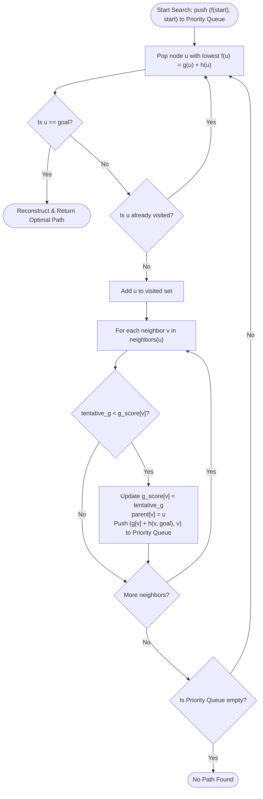

# A* Search Algorithm in Driving Environments

## 1. The Evaluation Function $f(n)$

While Dijkstra's algorithm searches uniformly in all directions from the origin ($g(n)$ alone), the **A\*** (A-Star) search algorithm focuses its exploration toward the goal by incorporating a heuristic estimation $h(n)$:

$$f(n) = g(n) + h(n)$$

Where:
- $g(n)$: Exact accumulated cost from the start node $s$ to node $n$.
- $h(n)$: Estimated remaining cost from node $n$ to the goal node $g$.
- $f(n)$: Estimated total cost of the cheapest path from $s$ to $g$ passing through node $n$.

---

## 2. A* Search Mechanics




```python
def a_star(graph, source, target, heuristic):
    # 1. Initialize data structures
    open_set = MinPriorityQueue()          # Min-heap automatically sorts lowest f(n) to front
    g_score = {node: float('inf') for node in graph.nodes}
    g_score[source] = 0.0
    prev = {node: None for node in graph.nodes}
    visited = set()                        # Closed set to avoid reprocessing expanded nodes
    
    # Seed priority queue with starting node: f(source) = g(source) + h(source, target) = h(source, target)
    open_set.push(source, priority=heuristic(source, target))
    
    # 2. Main exploration loop
    while not open_set.is_empty():
        u = open_set.extract_min()         # O(log V) extraction of node with lowest f(n)
        
        # Optimality guaranteed: goal reached upon extraction from open_set
        if u == target:
            return reconstruct_path(prev, u), g_score[u]
            
        # Duplicate entry check for min-heaps
        if u in visited:
            continue
        visited.add(u)
        
        # 3. Relax outgoing neighbors
        for v in graph.neighbors(u):
            edge_weight = graph.distance(u, v)
            tentative_g = g_score[u] + edge_weight
            
            # Discovered a strictly shorter path to neighbor v
            if tentative_g < g_score[v]:
                prev[v] = u
                g_score[v] = tentative_g
                f_score_v = tentative_g + heuristic(v, target)  # Total estimated path cost f(v) = g(v) + h(v)
                open_set.push(v, priority=f_score_v)
                
    return None, float('inf')              # Target unreachable
```

---

## 3. Advanced Informed Search Extensions

1. **Weighted A\* ($w > 1.0$):**
   $$f(n) = g(n) + w \cdot h(n)$$
   - Trades bounded $\epsilon$-suboptimality ($\text{Cost} \le w \cdot \text{Cost}^*$) for accelerated goal-directed convergence.

2. **Bidirectional A\*:**
   - Runs simultaneous forward search ($s \to t$) and backward search ($t \to s$), reducing search area from $\mathcal{O}(b^d)$ to $\mathcal{O}(2 \cdot b^{d/2})$.
   - See [04. Bidirectional A* Search](04_bidirectional_astar_search.md) for full mathematical formulation, directed graph traversal, and safe meeting termination criteria.

