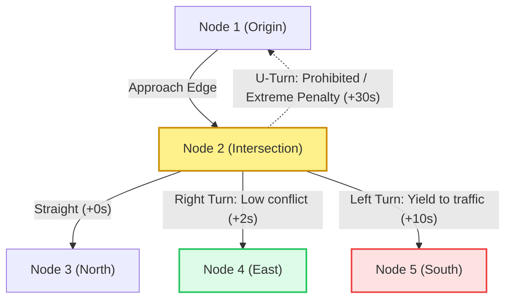

# Lane-Level Routing & Maneuver Penalties

## 1. Why Point-to-Point Graph Search is Insufficient

In realistic road networks, the cost of entering an edge $(v_j, v_k)$ depends on which edge $(v_i, v_j)$ the vehicle arrived from.

1. **Right Turns:** Minimal conflict with oncoming traffic; low delay penalty ($+2s$).
2. **Left Turns (Unprotected):** High risk, yielding required; substantial delay penalty ($+8s \sim +15s$).
3. **U-Turns:** Heavy penalty or legally prohibited ($+30s$).

---

## 2. Line Graphs / State Expansion for Turn Penalties

To model turn penalties in standard A*:
- **Edge-Based State Graph (Line Graph $\mathcal{G}^*$):**
  - States are directed edges $e = (u, v)$ rather than individual nodes.
  - Transitions are pairs of connected edges $(e_{in}, e_{out}) = ((u, v), (v, w))$.
  - Edge cost includes the maneuver penalty:

$$w((u,v) \to (v, w)) = \operatorname{travel\_time}(v, w) + \operatorname{turn\_penalty}(\theta_{uv}, \theta_{vw})$$

Where relative turn angle $\Delta \theta = \theta_{vw} - \theta_{uv}$:
$$\operatorname{turn\_penalty}(\Delta \theta) = \begin{cases}
0.0 & \text{if straight } (|\Delta \theta| < 15^\circ) \\
2.0 & \text{if right turn } (-105^\circ < \Delta \theta < -75^\circ) \\
10.0 & \text{if left turn } (75^\circ < \Delta \theta < 105^\circ) \\
30.0 & \text{if U-turn } (|\Delta \theta| > 150^\circ)
\end{cases}$$
