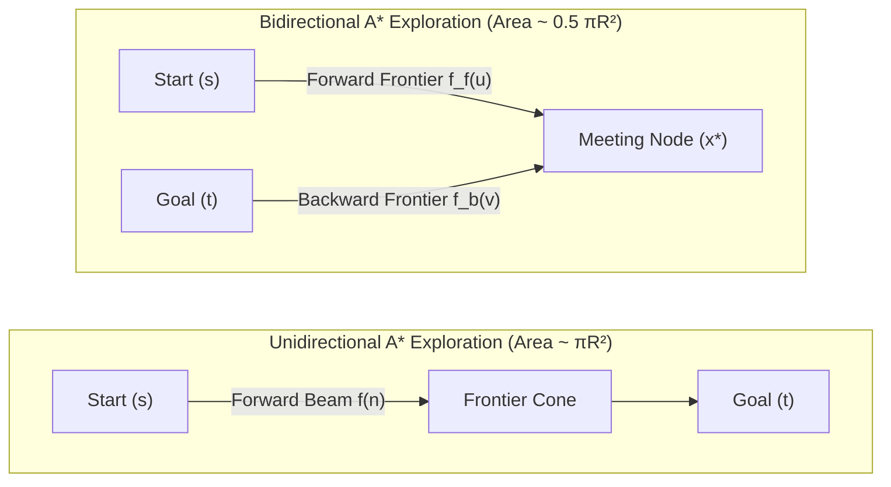
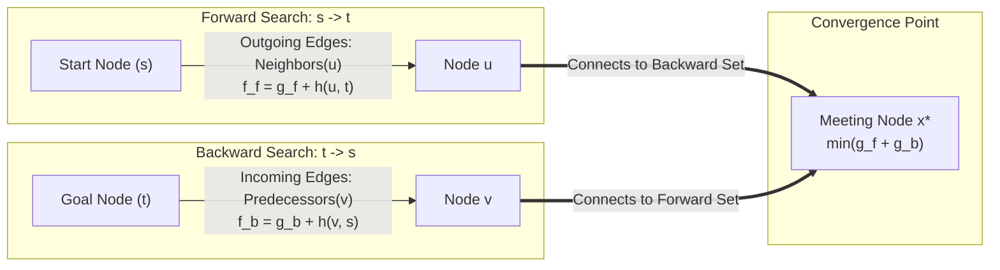
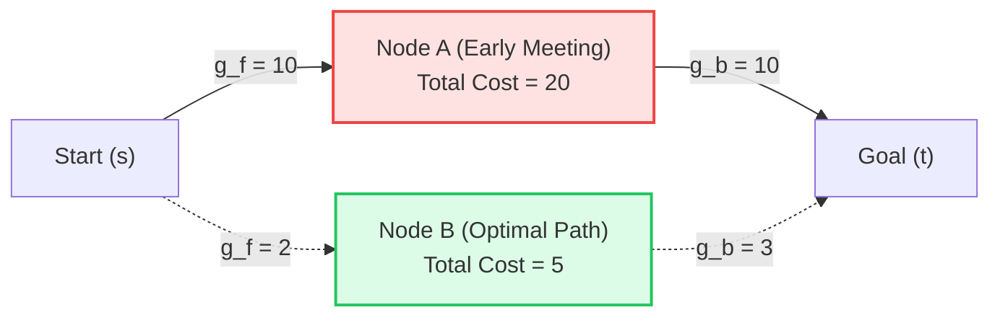
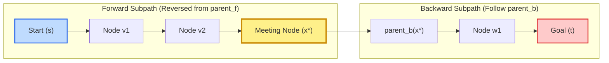

# Bidirectional A* Search Algorithm in Road Networks

## 1. Motivation: The Search Radius Dilemma

In uninformed and forward-informed search algorithms (Dijkstra and Unidirectional $A^*$), the search frontier radiates outward from the origin $s$ until it reaches destination $t$:

- In a uniform planar graph, a unidirectional search covering distance $R$ explores an area proportional to:
  $$\text{Area}_{\text{uni}} \approx \pi R^2$$
- In terms of branching factor $b$ and depth $d$, the time and space complexity scales as $\mathcal{O}(b^d)$.

If instead we grow **two simultaneous search frontiers**—one expanding forward from start $s$ and one expanding backward from destination $t$—the two wavefronts meet when each has covered approximately radius $R/2$:

$$\text{Area}_{\text{bi}} \approx \pi \left(\frac{R}{2}\right)^2 + \pi \left(\frac{R}{2}\right)^2 = 2 \times \frac{\pi R^2}{4} = \frac{1}{2} \pi R^2$$

In exponential tree terms, this reduces complexity from $\mathcal{O}(b^d)$ to:
$$\mathcal{O}\left(2 \cdot b^{d/2}\right)$$

In real-world road networks (such as OpenStreetMap urban grids), Bidirectional $A^*$ regularly eliminates **$70\% \text{ to } 85\%$** of node expansions compared to Dijkstra, and **$50\% \text{ to } 70\%$** compared to forward $A^*$.



---

## 2. Mathematical Formulation & Dual Wavefronts

Let $\mathcal{G} = (\mathcal{V}, \mathcal{E})$ be a directed road graph with positive edge weights $w(u, v) > 0$.



### Forward Search ($\vec{F}$):
- **Origin**: Start node $s$
- **Target**: Goal node $t$
- **Forward Traversal**: Outgoing edges $\mathcal{N}^+(u) = \{ v \in \mathcal{V} \mid (u, v) \in \mathcal{E} \}$
- **Cost-to-come**: $g_f(u)$ (exact accumulated cost from $s$ to $u$)
- **Forward Heuristic**: $h_f(u) = h(u, t)$ (estimated remaining cost from $u$ to $t$)
- **Forward Evaluation**: $f_f(u) = g_f(u) + h_f(u)$

### Backward Search ($\overleftarrow{B}$):
- **Origin**: Goal node $t$
- **Target**: Start node $s$
- **Backward Traversal**: Incoming predecessor edges $\mathcal{N}^-(v) = \{ u \in \mathcal{V} \mid (u, v) \in \mathcal{E} \}$
- **Cost-to-come**: $g_b(v)$ (exact accumulated cost from $v$ to $t$ along directed edges)
- **Backward Heuristic**: $h_b(v) = h(v, s)$ (estimated remaining cost from $v$ back to $s$)
- **Backward Evaluation**: $f_b(v) = g_b(v) + h_b(v)$

> [!IMPORTANT]
> **Directed Graph Warning:** On directed road topologies (one-way streets, divided highways), the backward search **must traverse incoming edges in reverse** ($u \to v$ evaluated from $v$ to $u$). Simply querying `neighbors(v)` in a directed graph would travel against the flow of traffic!

---

## 3. The Meeting & Safe Termination Criteria

### Why We Cannot Stop at First Intersection
In standard Dijkstra/A*, the search terminates the instant the goal node is popped from the priority queue. 

In **Bidirectional search**, when a node $u$ is visited by both searches, a complete path $s \to u \to t$ of cost $g_f(u) + g_b(u)$ is discovered. However, **this first meeting path is NOT guaranteed to be globally optimal**! A cheaper path might intersect at a different, not-yet-expanded node.



### Tracking the Best Incumbent Cost ($\mu$)
Maintain a variable $\mu$ storing the cheapest complete connection discovered so far:
$$\mu = \min_{x \in \mathcal{V}} \left( g_f(x) + g_b(x) \right)$$
and record the corresponding meeting node $x^* = \arg\min_x (g_f(x) + g_b(x))$.


### Stopping Condition
The search can safely terminate with the guaranteed optimal path when:

$$\min_{u \in Q_f} f_f(u) + \min_{v \in Q_b} f_b(v) \ge \mu + h(s, t)$$

or more compactly, for consistent Euclidean heuristics:
$$f_f(\text{top}) + f_b(\text{top}) \ge \mu + h(s, t)$$

When this condition is satisfied, no unexplored path through any remaining frontier node can ever achieve a total cost less than $\mu$.

```python
def bidirectional_a_star(graph, source, target, heuristic):
    # 1. Dual priority queues & distance maps
    open_F = MinPriorityQueue()
    open_B = MinPriorityQueue()
    
    g_F = {node: float('inf') for node in graph.nodes}
    g_B = {node: float('inf') for node in graph.nodes}
    prev_F = {node: None for node in graph.nodes}
    prev_B = {node: None for node in graph.nodes}
    visited_F = set()
    visited_B = set()
    
    g_F[source] = 0.0
    g_B[target] = 0.0
    h_st = heuristic(source, target)
    
    open_F.push(source, priority=h_st)
    open_B.push(target, priority=heuristic(target, source))
    
    mu = float('inf')                            # Best incumbent path cost found so far
    meeting_node = None
    
    # 2. Dual search loop
    while not open_F.is_empty() and not open_B.is_empty():
        u = open_F.peek_min()
        v = open_B.peek_min()
        
        # Mathematical guaranteed stopping condition (Ikeda / Pohl)
        if open_F.peek_min_priority() + open_B.peek_min_priority() >= mu + h_st:
            return reconstruct_bidirectional_path(prev_F, prev_B, meeting_node), mu
            
        # Balanced expansion: step the smaller frontier
        if len(open_F) <= len(open_B):
            expand_forward(open_F.extract_min(), graph, target, heuristic)
        else:
            expand_backward(open_B.extract_min(), graph, source, heuristic)  # Must traverse predecessors in directed graphs!
            
    return None, float('inf')
```

---

## 4. Complete Bidirectional A* Reference Implementation

```python
def bidirectional_astar(graph, start, goal, heuristic, max_speed):
    if start == goal:
        return [start], 0.0

    # 1. Forward search initialization
    g_f = {node: infinity for node in graph.nodes}
    g_f[start] = 0.0
    parent_f = {node: None for node in graph.nodes}
    pq_f = PriorityQueue()
    pq_f.push(priority=heuristic(start, goal), g_val=0.0, node=start)
    visited_f = set()

    # 2. Backward search initialization
    g_b = {node: infinity for node in graph.nodes}
    g_b[goal] = 0.0
    parent_b = {node: None for node in graph.nodes}
    pq_b = PriorityQueue()
    pq_b.push(priority=heuristic(goal, start), g_val=0.0, node=goal)
    visited_b = set()

    best_cost = infinity
    meeting_node = None
    h_st = heuristic(start, goal)

    # 3. Main search loop
    while not pq_f.is_empty() and not pq_b.is_empty():
        # Termination check
        if pq_f.peek_min_f() + pq_b.peek_min_f() >= best_cost + h_st:
            break

        # Balanced expansion: step the smaller frontier
        if len(pq_f) <= len(pq_b):
            f_u, g_u, u = pq_f.pop_min()
            if u in visited_f:
                continue
            visited_f.add(u)

            # Check for connection with backward closed set
            if u in visited_b and g_u + g_b[u] < best_cost:
                best_cost = g_u + g_b[u]
                meeting_node = u

            # Relax outgoing forward edges
            for v in graph.neighbors(u):
                w = graph.edge_weight(u, v)
                tentative_g = g_u + w
                if tentative_g < g_f[v]:
                    g_f[v] = tentative_g
                    parent_f[v] = u
                    f_v = tentative_g + heuristic(v, goal)
                    pq_f.push(priority=f_v, g_val=tentative_g, node=v)
                    if v in visited_b and tentative_g + g_b[v] < best_cost:
                        best_cost = tentative_g + g_b[v]
                        meeting_node = v
        else:
            f_v, g_v, v = pq_b.pop_min()
            if v in visited_b:
                continue
            visited_b.add(v)

            # Check for connection with forward closed set
            if v in visited_f and g_f[v] + g_v < best_cost:
                best_cost = g_f[v] + g_v
                meeting_node = v

            # Relax incoming backward edges (predecessors!)
            for u in graph.predecessors(v):
                w = graph.edge_weight(u, v)
                tentative_g = g_v + w
                if tentative_g < g_b[u]:
                    g_b[u] = tentative_g
                    parent_b[u] = v
                    f_u = tentative_g + heuristic(u, start)
                    pq_b.push(priority=f_u, g_val=tentative_g, node=u)
                    if u in visited_f and g_f[u] + tentative_g < best_cost:
                        best_cost = g_f[u] + tentative_g
                        meeting_node = u

    # 4. Path Reconstruction across meeting node
    if meeting_node is None:
        return [], infinity

    # Forward half: start -> meeting_node
    path_forward = []
    curr = meeting_node
    while curr is not None:
        path_forward.append(curr)
        curr = parent_f[curr]
    path_forward.reverse()

    # Backward half: meeting_node -> goal
    path_backward = []
    curr = parent_b[meeting_node]
    while curr is not None:
        path_backward.append(curr)
        curr = parent_b[curr]

    full_path = path_forward + path_backward
    return full_path, best_cost
```

---

## 5. Path Reconstruction Across the Meeting Node

Once the optimal meeting node $x^*$ is identified:
1. **Trace Forward**: Follow `parent_f` pointers from $x^*$ back to start node $s$, then reverse the list:
   $$\text{Path}_f = [s, v_1, v_2, \dots, x^*]$$
2. **Trace Backward**: Follow `parent_b` pointers from $\text{parent}_b(x^*)$ down to goal node $t$:
   $$\text{Path}_b = [\text{parent}_b(x^*), \dots, t]$$
3. **Concatenate**:
   $$\text{Optimal Path} = \text{Path}_f \parallel \text{Path}_b = [s, v_1, \dots, x^*, \dots, t]$$




---

## 6. Comparison Summary: Dijkstra vs A* vs Bidirectional A*

| Dimension | Dijkstra | Forward A* ($w=1.0$) | Weighted A* ($w > 1.0$) | Bidirectional A* |
| :--- | :--- | :--- | :--- | :--- |
| **Search Frontiers** | 1 (Forward from $s$) | 1 (Forward from $s$) | 1 (Forward from $s$) | 2 (Simultaneous $s \to t$ & $t \to s$) |
| **Heuristic Usage** | None ($h=0$) | $h(u, t)$ | $w \cdot h(u, t)$ ($w > 1$) | $h_f(u, t)$ and $h_b(v, s)$ |
| **Frontier Shape** | Radial circle / sphere | Elliptical / cone toward goal | Narrow beam toward goal | Dual meeting cones |
| **Optimality Guarantee** | $\checkmark$ Exact Optimal | $\checkmark$ Exact Optimal | $\epsilon$-Suboptimal ($\le w \cdot C^*$) | $\checkmark$ Exact Optimal |
| **Explored Nodes (Urban Map)** | $95\% - 100\%$ of map | $50\% - 70\%$ of map | $35\% - 50\%$ of map | **$15\% - 25\%$ of map** |
| **Relative Node Reduction** | Baseline ($0\%$) | $30\% - 50\%$ | $50\% - 65\%$ | **$75\% - 85\%$** |
