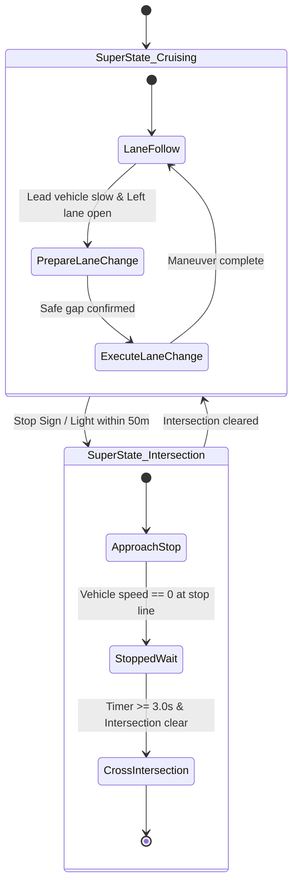

# Finite State Machines & Hierarchical State Machines (HSMs)

## 1. Formal Definition of Finite State Machines (FSMs)

An FSM is defined as a 5-tuple:
$$\mathcal{M} = (\mathcal{S}, \Sigma, \delta, s_0, \mathcal{F})$$

- $\mathcal{S}$: Finite set of discrete driving states (e.g. `LANE_FOLLOW`, `DECELERATE_TO_STOP`, `STAY_STOPPED`, `INTERSECTION_CROSS`).
- $\Sigma$: Set of environment inputs and perception events (e.g. `lead_vehicle_detected`, `distance_to_stop_sign < d_thresh`, `wait_timer_expired`).
- $\delta: \mathcal{S} \times \Sigma \to \mathcal{S}$: State transition function governed by **Guard Conditions**.
- $s_0 \in \mathcal{S}$: Initial state.
- $\mathcal{F} \subseteq \mathcal{S}$: Final / Terminal states.

---

## 2. The State Explosion Problem & HSM Decomposition

Flat FSMs suffer from combinatorial explosion when handling complex urban maneuvers (e.g., handling lane changes inside or outside construction zones across varied road classes).

### Advantages of HSMs
- **Encapsulation:** Sub-states within a super-state inherit common safety transitions (e.g. `EMERGENCY_BRAKE` can interrupt any sub-state).
- **Modularity:** Scenario-specific logic (e.g. parking vs roundabout negotiation) is isolated into separate state hierarchies.
