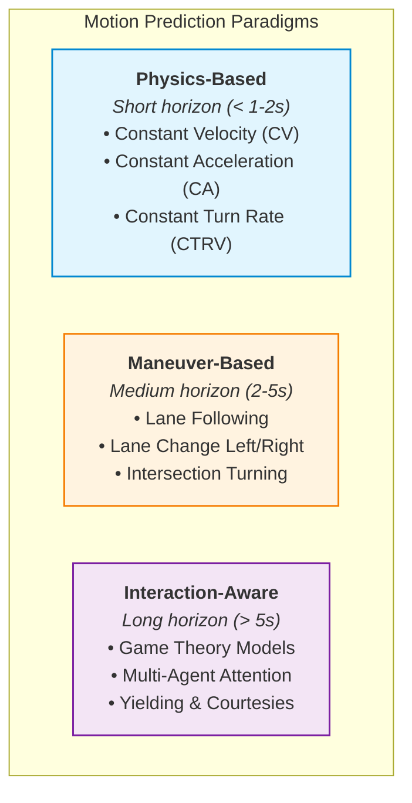

# Dynamic Motion Prediction Paradigms

## 1. Classification of Motion Prediction Models

To safely plan motion around other traffic participants (vehicles, cyclists, pedestrians), autonomous vehicles forecast future trajectory distributions $\mathcal{P}(\mathbf{x}_{1:T}^{obs} \mid \mathbf{x}_{0}^{obs}, \text{Map})$:

---

## 2. Physics-Based State Propagations

### Constant Velocity (CV) Model
Assuming velocity $v$ and heading $\theta$ remain constant over short horizons $\Delta t$:
$$x(t) = x_0 + v \cos(\theta) t, \quad y(t) = y_0 + v \sin(\theta) t$$

### Constant Turn Rate and Velocity (CTRV) Model
For yaw rate $\omega = \dot{\theta} \neq 0$:
$$x(t) = x_0 + \frac{v}{\omega} \left( \sin(\theta_0 + \omega t) - \sin(\theta_0) \right)$$
$$y(t) = y_0 + \frac{v}{\omega} \left( -\cos(\theta_0 + \omega t) + \cos(\theta_0) \right)$$
$$\theta(t) = \theta_0 + \omega t$$
