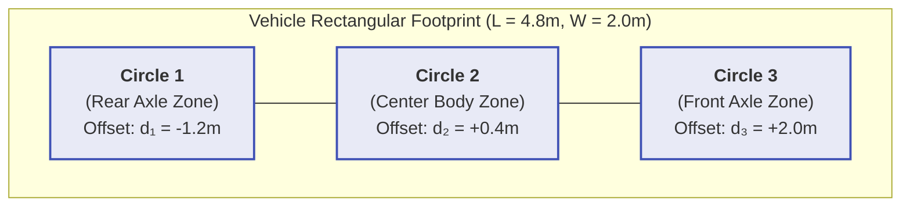

# Swaths & Multi-Circle Collision Checking

## 1. Multi-Circle Vehicle Footprint Model

Full polygon-polygon intersection checking along continuous trajectories is computationally expensive. Autonomous planners approximate the rectangular vehicle footprint with **$N$ overlapping circles** placed along the vehicle centerline:

For a vehicle with length $L_{veh} = 4.8m$, width $W_{veh} = 2.0m$, and $N = 3$ circles:
- Radius $R = \sqrt{\left(\frac{L_{veh}}{2N}\right)^2 + \left(\frac{W_{veh}}{2}\right)^2} \approx 1.28m$.
- Circle offsets along body x-axis: $d_i = \{-1.2m, 0.4m, 2.0m\}$.

---

## 2. Fast Collision Checking Algorithm

For each trajectory point $(x_k, y_k, \theta_k)$ and each circle $i$:
1. Compute circle center in global coordinates:
   $$x_{c, i} = x_k + d_i \cos(\theta_k)$$
   $$y_{c, i} = y_k + d_i \sin(\theta_k)$$
2. Check Euclidean distance to all obstacle points $(x_{obs}, y_{obs})$:
   $$\text{Collision if } \sqrt{(x_{c, i} - x_{obs})^2 + (y_{c, i} - y_{obs})^2} \le R + R_{obs\_buffer}$$
