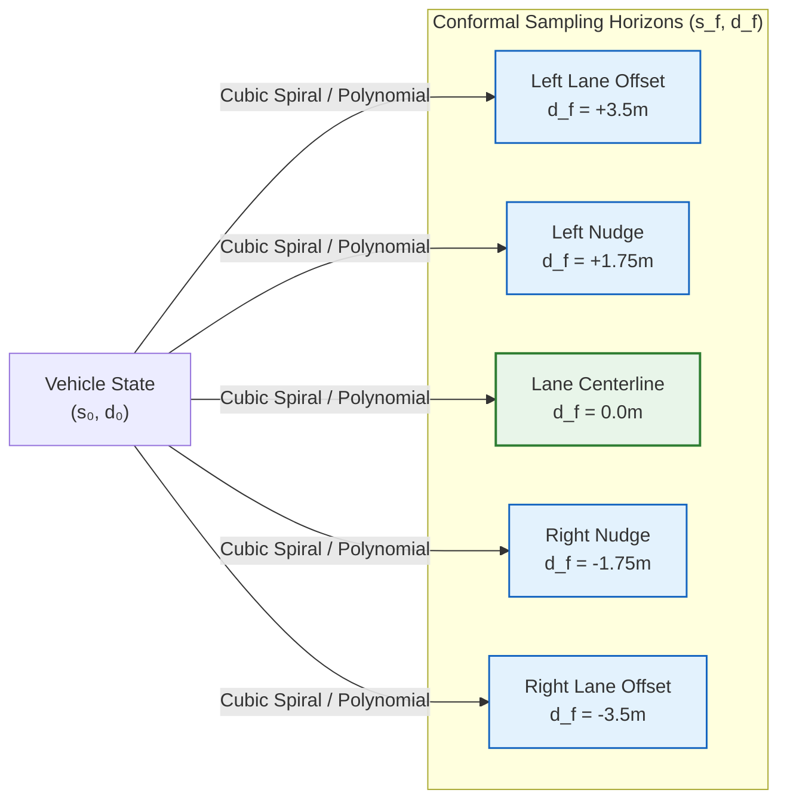

# Conformal Spatiotemporal Lattices

## 1. Conformal Lattice Concept

Rather than generating arbitrary random paths in global Cartesian space $(x, y)$, a **Conformal Lattice** samples trajectories aligned with the road geometry:

A discrete grid of target boundary states $(s_f, d_f)$ is placed at fixed lookahead distances:
- Longitudinal horizons: $s_f \in \{20m, 30m, 40m, 50m\}$
- Lateral offsets: $d_f \in \{-3.5m, -1.75m, 0.0m, +1.75m, +3.5m\}$

For each $(s_f, d_f)$, an optimal quintic polynomial or cubic spiral curve is generated, forming a structured bundle of lane-conforming paths.
