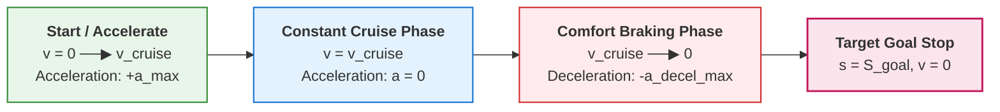

# Trapezoidal Profiles & Dynamic Limits

## 1. Classical Trapezoidal Velocity Profile

For straight line segments, a velocity profile accelerating at $+a_{max}$, cruising at $v_{cruise}$, and decelerating at $-a_{max}$ forms a trapezoid in $(t, v)$ or parabolic profile in $(s, v^2)$:

### Critical Braking Distance
To come to a complete stop from speed $v_0$ with maximum comfort deceleration $a_{brake} \approx 2.5 m/s^2$:

$$d_{brake} = \frac{v_0^2}{2 a_{brake}}$$

If remaining distance to stop sign $d_{remaining} < d_{brake}$, the vehicle cannot stop smoothly without emergency friction braking.
