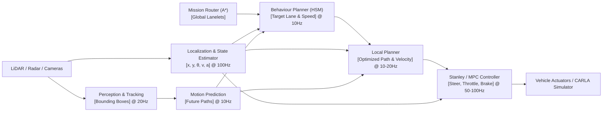

# End-to-End Autonomous Driving Planning Architecture

## 1. System Integration Pipeline

In production autonomous driving stacks (and in the CARLA simulator), data flows sequentially through perception, prediction, planning, and control:

---

## 2. Module Interface Contracts

- **Mission $\to$ Behaviour:** Ordered list of lanelet IDs / reference path waypoints.
- **Behaviour $\to$ Local:**
  - `target_lane_id`: Centerline reference for local lattice generation.
  - `target_velocity`: Cruising or stop-approach speed target.
  - `mandatory_stop_point`: $[s_{stop}, x_{stop}, y_{stop}]$ or `None`.
- **Local $\to$ Control:**
  - Time-parameterized trajectory $\tau = [x(t), y(t), \theta(t), v(t), \kappa(t)]$ for lookahead horizon $T_{lookahead} \approx 2.0\sim 3.0s$.
