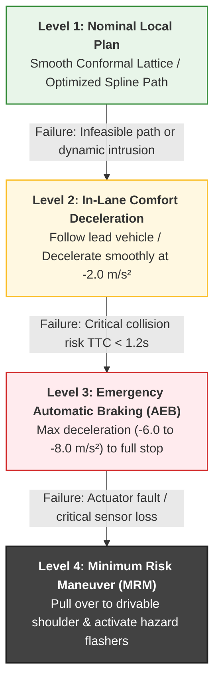

# Closed-Loop Feedback & Safety Fallback Layers

## 1. Real-Time Closed-Loop Replanning

At each planning tick (e.g. every $\Delta t_{plan} = 100\text{ms}$):
1. Receive updated vehicle ego pose from localization.
2. Determine current position along the active trajectory and find nearest reference path waypoint.
3. Propagate forward from current dynamic state $[x_0, y_0, \theta_0, v_0]$ to ensure smooth continuity (preventing control step jumps).
4. Re-evaluate static and dynamic obstacles and regenerate/optimize the local trajectory.

---

## 2. Safety Verification & Fallback Hierarchy

If the local optimizer fails to find a valid collision-free trajectory or if an unexpected obstacle cuts into the vehicle's safety envelope:

